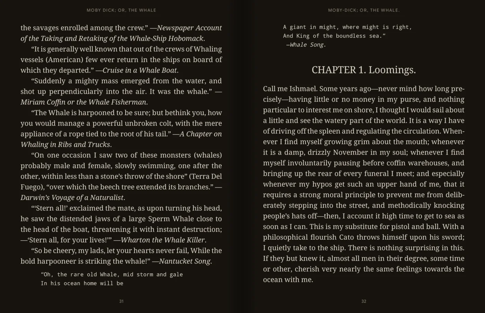
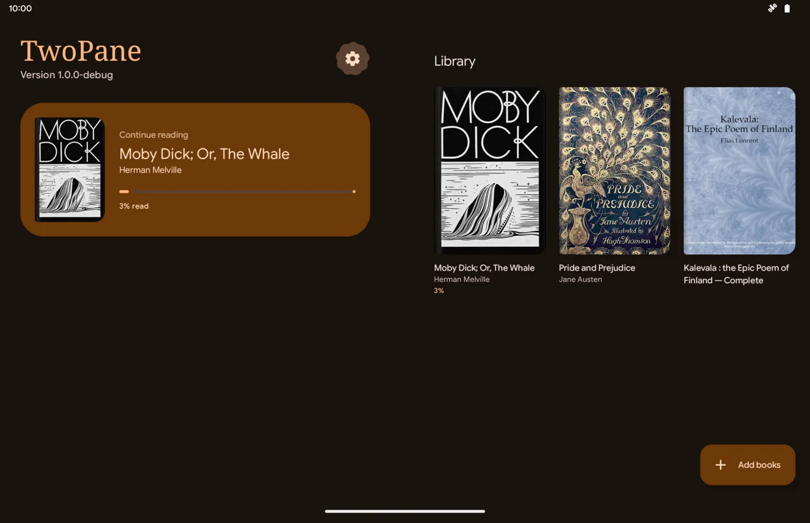
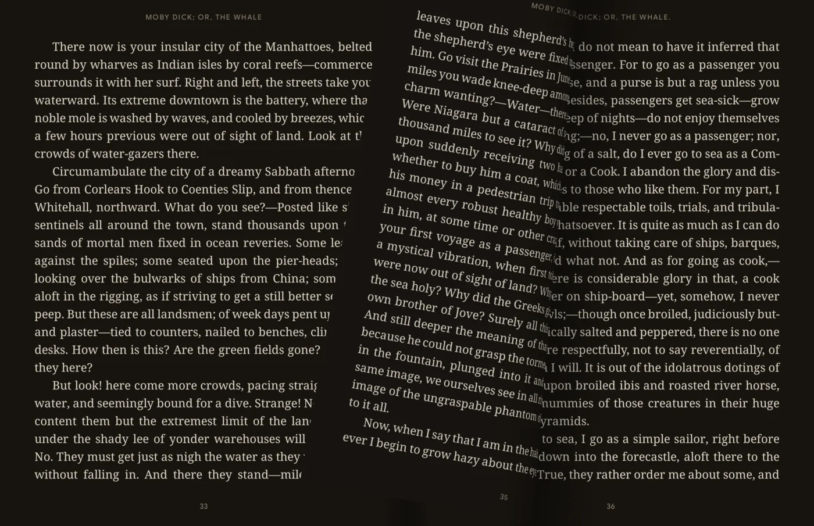
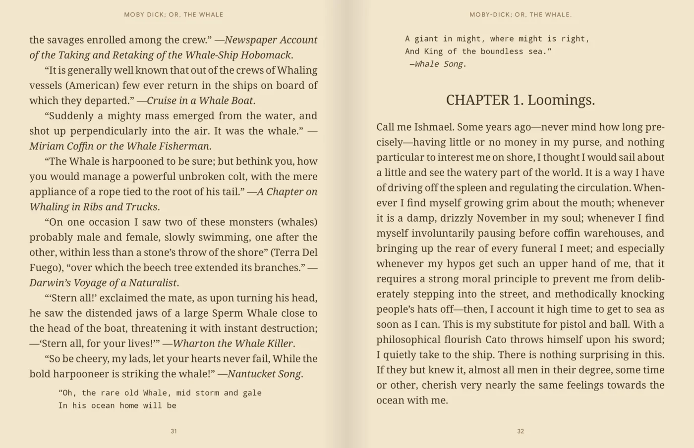
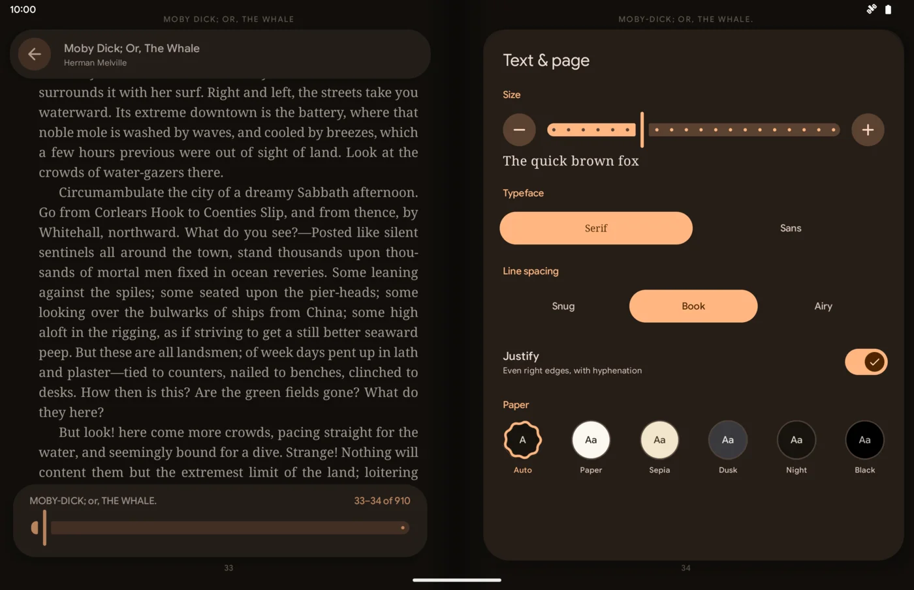
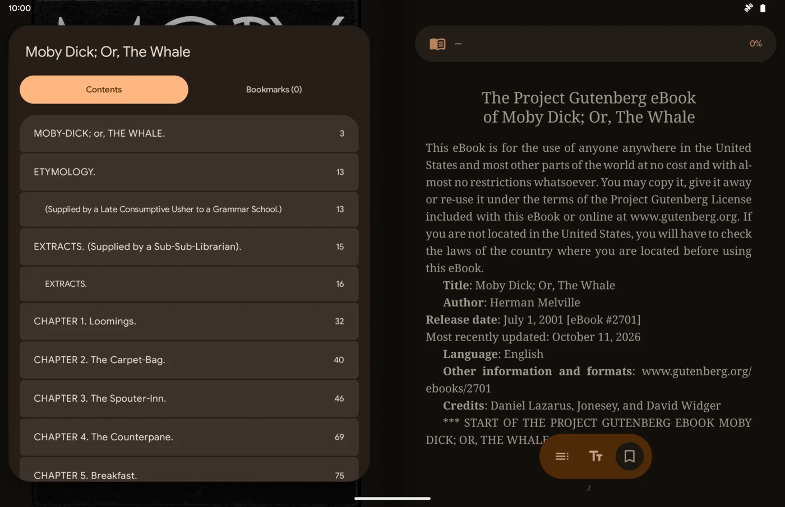
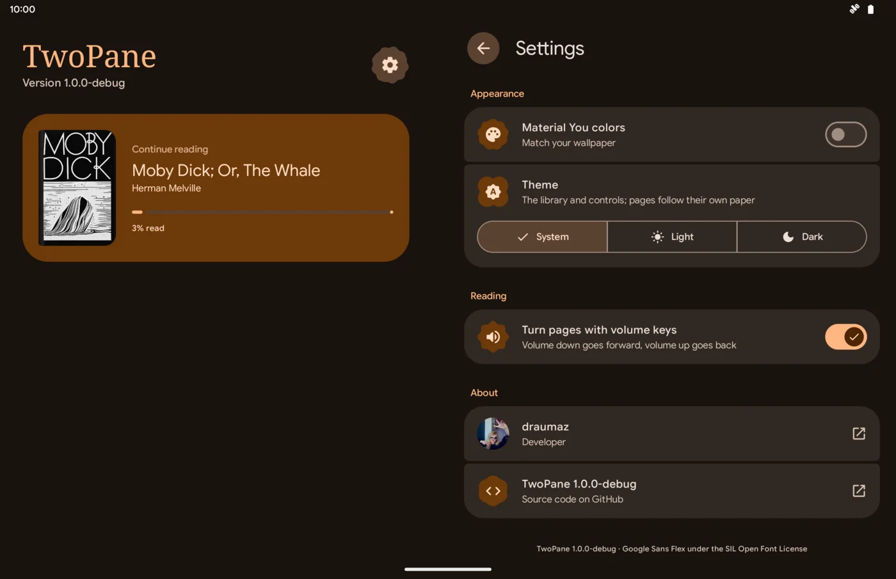
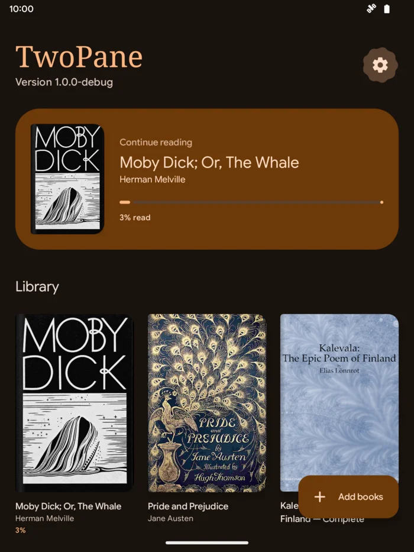
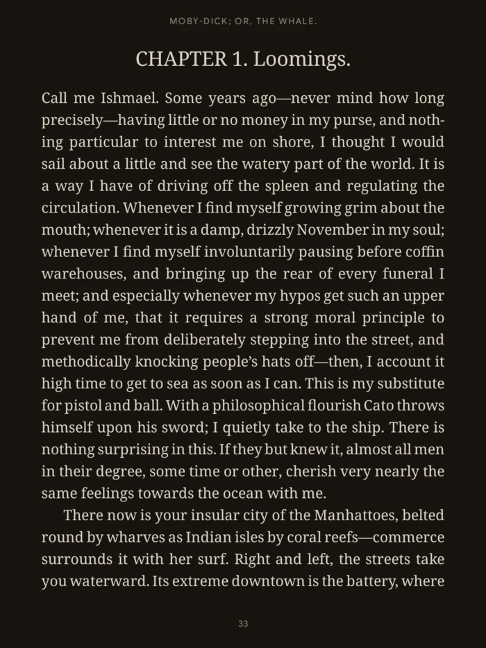

# TwoPane

An e-reader for Android, written in Kotlin with Jetpack Compose and Material 3 Expressive.
It's built for the Surface Duo and other wide foldables: with the app spanned, a book opens
across both screens and the hinge is the spine.



## Screenshots

| | |
|---|---|
|  |  |
| Library, with the book you're reading up front | The page curl follows your finger across the hinge |
|  |  |
| Sepia paper | Type size, typeface, line spacing, justification and paper |
|  |  |
| Contents and bookmarks | Settings |
|  |  |
| On one screen, the library stacks | and the book shows a page at a time |

Books shown are from [Project Gutenberg](https://www.gutenberg.org).

## Features

- EPUB 2 and 3, and plain text (including Project Gutenberg files)
- Two pages side by side when spanned, one page on a single screen or phone
- Page curl that follows your finger, including across the hinge
- Justified, hyphenated text with widow and orphan control
- Contents, bookmarks, type size, serif or sans, line spacing and six paper colours
- Page turns with the volume keys

## Building

Requires the Android SDK with platform 37.2. Gradle downloads its own JDK.

```sh
./gradlew installDebug
```

Books can be added from the library, opened from a file manager, or pushed over adb to
`Android/data/xyz.draumaz.twopane.debug/files/import/`. They're picked up the next time the app starts.

## Fonts

Google Sans Flex is under the SIL Open Font License (see `third_party/fonts`).
