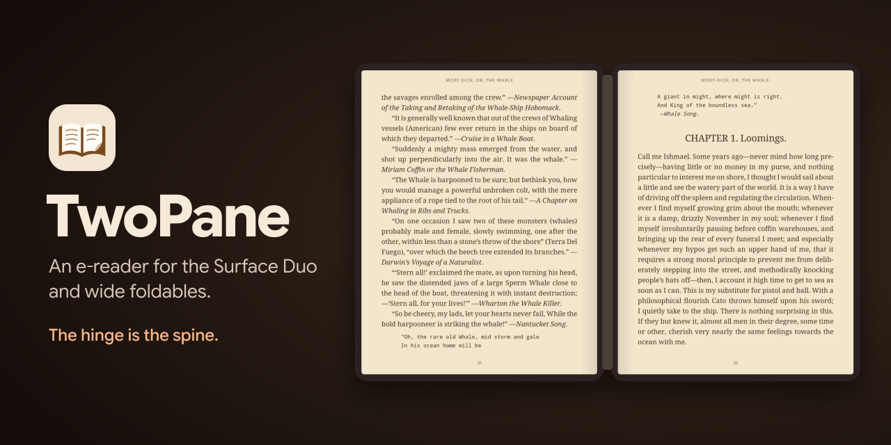

# TwoPane 1.0.0

TwoPane is an e-reader for Android, made for the Surface Duo and other wide foldables. Span the
app across both screens and a book opens like a real one: two pages side by side, with the
hinge as the spine. On a single screen or a phone it shows one page at a time.

This is the first stable release.

## What it does

- **Reads EPUB 2, EPUB 3 and plain text**, including Project Gutenberg files, with their
  licence header and footer trimmed away.
- **Two-page spreads** when spanned or on a wide tablet; nothing is ever drawn into the hinge.
- **A page curl that follows your finger**, even across the Duo's hinge from one screen to the other.
- **Book-quality typesetting**: justified, hyphenated text with widow and orphan control and
  no indent on a chapter's first paragraph.
- **Contents and bookmarks**, with page numbers, and a scrubber to move anywhere in the book.
- **Your choice of type and paper**: type size, serif or sans, line spacing, justification and
  six paper colours (Auto, Paper, Sepia, Dusk, Night and Black).
- **Volume keys turn pages** (and this can be turned off).
- **Material 3 Expressive**, with Material You colours from your wallpaper or TwoPane's own
  palette, and light, dark or system theme.

## Getting books in

- Tap **Add books** in the library and pick EPUB or text files.
- Open a book with TwoPane from a file manager, or share one to it from another app.
- Or push files over adb to `Android/data/xyz.draumaz.twopane/files/import/`; they're added the
  next time the app starts.

Everything stays on your device: TwoPane needs no account and no internet permission.

## Install

Download the APK attached below and open it on your device. TwoPane needs Android 10 or later.

## Licence

TwoPane is free software under the GNU General Public License v3.0. Google Sans Flex is under
the SIL Open Font License.
